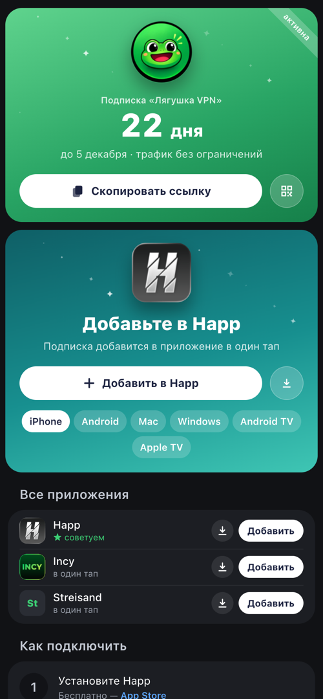
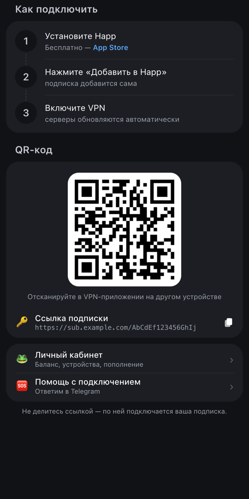

# 🐸 Лягушка VPN: страница подписки

Страница, которую видит человек, когда открывает ссылку подписки Remnawave в браузере, а не в VPN-приложении.
Она сделана в стиле личного кабинета «Лягушка VPN»: карточки-виджеты, лягушка, искорки, счётчик дней и конфетти.

<p align="center">
  
  
</p>

## Что на странице

- **Статус подписки**: активна, истекла, отключена или закончился трафик. Цвет карточки зависит от статуса, ниже показаны срок, оставшиеся дни и трафик.
- **«Добавить в приложение» в один тап** через диплинки Happ, Incy, Streisand и v2rayNG. Для v2rayN, у которого нет диплинка, есть кнопка «Копировать».
- **Ссылки на установку** для iPhone, Android, Mac, Windows, Android TV и Apple TV. Платформа определяется по устройству, её можно переключить чипами.
- **QR-код** для подключения другого устройства и **копирование ссылки**.
- Ссылки на личный кабинет и поддержку.

Страница собирается в один HTML-файл без внешних запросов: иконки, стили, скрипты и QR-библиотека встроены в него.

## Как это работает

На домене подписки работает стандартный контейнер [`remnawave/subscription-page`](https://github.com/remnawave/subscription-page).
VPN-приложениям он отдаёт конфиг, а браузеру — HTML. Для браузера он рендерит файл
`/opt/app/frontend/index.html` как EJS-шаблон и подставляет в `<%- panelData %>` данные подписки:
base64 от JSON `GetSubscriptionInfoByShortUuid` с полями `user.userStatus`, `user.expiresAt`, `user.trafficUsedBytes`,
`user.trafficLimitBytes` и `subscriptionUrl`.

Мы монтируем свой `dist/index.html` поверх этого файла. Бэкенд Remnawave остаётся прежним: домен панели
по-прежнему скрыт, ссылки подписки не меняются, VPN-приложения ничего не замечают.

## Установка

Ниже стандартная установка по [документации Remnawave](https://docs.rw/docs/install/remnawave-subscription-page), где контейнер лежит в `/opt/remnawave/subscription`.

```bash
cd /opt/remnawave/subscription
curl -fsSL -o index.html https://raw.githubusercontent.com/asdasdasdasdasdasdaadas/lyagushka-sub-page/main/dist/index.html
```

В `docker-compose.yml` добавьте у сервиса `remnawave-subscription-page` строку в `volumes`
(полный пример лежит в [`docker-compose.example.yml`](docker-compose.example.yml)):

```yaml
    volumes:
      - ./index.html:/opt/app/frontend/index.html:ro
```

Пересоздайте контейнер:

```bash
docker compose up -d
```

Проверьте, что файл подменился. Если команда вывела не ноль, всё на месте:

```bash
docker exec remnawave-subscription-page grep -c "Лягушка VPN" /opt/app/frontend/index.html
```

**Обновление.** Скачайте файл заново и перезапустите контейнер: шаблон читается только при старте.

```bash
cd /opt/remnawave/subscription && curl -fsSL -o index.html https://raw.githubusercontent.com/asdasdasdasdasdasdaadas/lyagushka-sub-page/main/dist/index.html && docker compose restart
```

**Откат.** Уберите строку из `volumes` и выполните `docker compose up -d`. Вернётся стандартная страница.

## Настройка и сборка

| Файл | Что в нём |
| --- | --- |
| `src/page.html` | Вёрстка, стили и логика страницы с плейсхолдерами `@@…@@`. |
| `apps.json` | Приложения: название, диплинк, платформы и ссылки на магазины. |
| `config.json` | Заголовок страницы, ссылки на поддержку и личный кабинет. |
| `icons/` | Лягушка и иконки приложений, PNG до 128 px. Если иконки нет, показываются буквы из поля `mark`. |
| `vendor/qrcode.min.js` | Библиотека [qrcode-generator](https://github.com/kazuhikoarase/qrcode-generator) (MIT). |

Сборку запускает только стандартная библиотека Python 3.9+:

```bash
python3 build.py
```

Скрипт создаёт два файла:

- `dist/index.html` — шаблон для контейнера, его коммитим;
- `dist/preview.html` — та же страница с демо-данными. Его можно открыть в браузере, в git он не попадает.

### Приложения и диплинки

В шаблоне диплинка из `apps.json` есть два плейсхолдера:

- `{url}` — ссылка подписки как есть, например `happ://add/{url}`;
- `{enc}` — ссылка подписки, закодированная для query-параметра, например `v2rayng://install-sub?url={enc}`.

Если диплинк пустой, вместо кнопки «Добавить» будет «Копировать». Первое приложение платформы
получает метку «★ советуем» и попадает в большую карточку подключения.

Допустимые платформы: `ios`, `android`, `macos`, `windows`, `androidtv`, `appletv`.

## Совместимость

Страница проверена с Remnawave Panel 3.4 и `remnawave/subscription-page:latest` (ноябрь 2026).
Она держится на одном договоре с контейнером: файл `/opt/app/frontend/index.html` и переменная `panelData`.
После обновления образа откройте свою ссылку подписки в браузере и убедитесь, что страница на месте.
